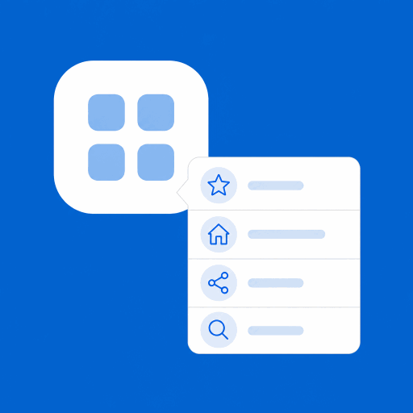

# Quick Actions App Shortcuts

<p align="center">
  
</p>

[](CHANGELOG.md)
[](https://godotengine.org)
[](#platform-notes)
[](LICENSE)

Godot 4 plugin that adds a **Send feedback** shortcut to the iOS / Android app-icon long-press menu. Tapping it opens the system mail composer with a pre-filled recipient, subject, and diagnostics.

**v0.1 focus:** static mailto feedback only. No game-side GDScript or scene node is required.

## Problem

Users often uninstall without saying why. A home-screen shortcut is a low-friction way to capture feedback — including from people who were about to leave.

## Solution

1. Long-press the app icon
2. Tap **Send feedback** (compose / mail icon)
3. Mail opens with your support address and useful device info

| Platform    | Behavior                                                               |
| ----------- | ---------------------------------------------------------------------- |
| **Android** | Trampoline activity opens Mail and finishes. Godot does **not** start. |
| **iOS**     | App launches/resumes (required by iOS), then opens Mail immediately.   |

## Requirements

- Godot **4.7+**
- Android: **Gradle Build** enabled in the export preset (min SDK of your game is unchanged; shortcuts need API 25+)
- iOS **17.0+**: enable the **QuickActionsAppShortcutsPlugin** in the iOS export preset plugins list

## Installation

From the Asset Library / release zip (contains only `addons/` + `ios/plugins/`):

1. Unpack into your project root
2. Project → Project Settings → Plugins → enable **Quick Actions App Shortcuts**
3. Copy `addons/QuickActionsAppShortcutsPlugin/quick_actions_app_shortcuts.cfg.example`
   to `res://quick_actions_app_shortcuts.cfg`, then set your recipient
4. Export Android / iOS as usual (iOS localization overlays are generated at export)

From this repo (developers): copy `addons/QuickActionsAppShortcutsPlugin/` and
`ios/plugins/` the same way.

Keep the `.cfg` **outside** `addons/` so plugin updates do not overwrite your email settings.

## Usage

```ini
# res://quick_actions_app_shortcuts.cfg
[feedback]
recipient="feedback@example.com"
title="Send feedback"
icon="compose"
subject_template="{{APP_NAME}} feedback"
body_template="Please share your feedback above this line.\n\nApp: {{APP_NAME}}\nVersion: {{APP_VERSION}}\nOS: {{OS_VERSION}}\nDevice: {{DEVICE_MODEL}}"
```

| Field              | Required | Notes                                   |
| ------------------ | -------- | --------------------------------------- |
| `recipient`        | yes      | Support inbox. Export fails if invalid. |
| `title`            | no       | Long-press menu label (default: `Send feedback`). |
| `icon`             | no       | Long-press menu icon id (default: `compose`). |
| `subject_template` | no       | Localized default if empty.             |
| `body_template`    | no       | Localized default if empty.             |

To turn the shortcut off, disable the plugin in Project Settings (or remove the `.cfg` file).

Placeholders (filled at tap time): `{{APP_NAME}}`, `{{APP_VERSION}}`, `{{OS_VERSION}}`, `{{DEVICE_MODEL}}`.

The app-icon shortcut creates the platform-specific email draft for you.

### In-game (optional)

```gdscript
var feedback := QuickActionsAppShortcuts.get_feedback_data()
if not feedback.is_empty():
	var mailto := "mailto:%s?subject=%s&body=%s" % [
		feedback["recipient"],
		str(feedback["subject"]).uri_encode(),
		str(feedback["body"]).uri_encode(),
	]
	OS.shell_open(mailto)
```

`get_feedback_data(locale)` only reads data; the game decides how to open or display it.
It returns `recipient`, selected `locale`, raw `subject_template` / `body_template`,
and rendered `subject` / `body` with diagnostic placeholders filled. Omit `locale` to
use `TranslationServer.get_locale()`.

### Shortcut title and icon (long-press menu)

`title` and `icon` control what the user sees after long-pressing the app icon.

**Icons** (`feedback.icon`) — system-style icons mapped on both platforms:

| Value       | Typical look                          |
| ----------- | ------------------------------------- |
| `compose`   | Compose on iOS; envelope on Android (default) |
| `mail`      | Envelope                              |
| `message`   | Chat bubble                           |
| `love`      | Heart                                 |
| `share`     | Share                                 |
| `bookmark`  | Bookmark                              |
| `search`    | Search                                |
| `home`      | Home                                  |

### Localization

Defaults under `[feedback]` are the fallback (usually English). Add one section per language code to localize the long-press **title** and/or the email **subject** / **body** templates:

```ini
[feedback]
recipient="feedback@example.com"
title="Send feedback"
icon="compose"
subject_template="{{APP_NAME}} feedback"
body_template="Please share your feedback above this line.\n\nApp: {{APP_NAME}}\nVersion: {{APP_VERSION}}\nOS: {{OS_VERSION}}\nDevice: {{DEVICE_MODEL}}"

[feedback.pl]
title="Wyślij opinię"
subject_template="Opinia o {{APP_NAME}}"
body_template="Napisz swoją opinię powyżej tej linii.\n\nAplikacja: {{APP_NAME}}\nWersja: {{APP_VERSION}}\nSystem: {{OS_VERSION}}\nUrządzenie: {{DEVICE_MODEL}}"

[feedback.de]
title="Feedback senden"
subject_template="Feedback zu {{APP_NAME}}"

[feedback.zh_CN]
title="发送反馈"
```

Notes:

- Section name is `feedback.<locale>` (examples: `pl`, `de`, `pt_BR`, `zh_CN`).
- Each locale section may set any of: `title`, `subject_template`, `body_template` (at least one required).
- Omitted fields fall back to the default `[feedback]` values.
- On **Android**, strings are written into the Gradle build resources at export (`values-<locale>/`) and chosen from the device language at tap time.
- On **iOS**, titles use `InfoPlist.strings`; when Godot already creates that locale for project translations, the plugin merges its title into the existing file. Subject/body use `Localizable.strings`.
- Subject/body templates are **plain text** (mailto), not HTML — use `\n` for line breaks, not `<br>`.
- If a locale is missing, the device falls back to the default `[feedback]` strings.
- If you leave default `subject_template` / `body_template` empty, the plugin’s built-in English defaults are used (still overridable per locale).

## Building native binaries (maintainers)

```bash
./scripts/build_android.sh   # needs Android SDK + JDK 17
./scripts/build_ios.sh       # needs Xcode
```

Outputs:

- `addons/QuickActionsAppShortcutsPlugin/bin/{debug,release}/*.aar`
- `ios/plugins/QuickActionsAppShortcutsPlugin.xcframework`

## Demo

Open the `demo/` folder in Godot 4.7+, set your real inbox in `quick_actions_app_shortcuts.cfg`, then remote-deploy to a device and long-press the icon.

Export presets are included (`Android` + `iOS`, both runnable):

1. **Android:**
   - Project → Install Android Build Template (once; creates `android/build`)
   - Connect a device (`adb devices` should list it)
   - Select the **Android** preset → Remote Debug → Run  
   - If you only see `ERROR: Run:` with an empty message, open **Project → Export** and read the red warnings (usually missing build template, Java SDK path, or ETC2 — the demo already enables ETC2).
2. **iOS:** select the **iOS** preset, set your Apple Team ID / signing, then Remote Debug → Run.

Package / bundle id: `com.noforcedads.qaasdemo`.

See [docs/TESTING.md](docs/TESTING.md) for the device checklist.

## Platform notes

- **Android API < 25:** app installs and runs; shortcut is simply absent.
- **Android title/icon overrides** require the Android build template (`Project → Install Android Build Template`) so export can write overlay resources.
- **iOS:** cold and warm quick actions are handled via Godot’s app-delegate hooks. A brief splash/launch can still appear before Mail — that is an iOS limitation.
- Invalid config fails export with a clear message; missing `.cfg` is a clean no-op.

## Privacy

- The plugin has no telemetry, network requests, or automatic sending.
- Recipient, subject, body, and diagnostics are placed in a local email draft only after the user taps the shortcut. The user can review, edit, or discard it.
- `recipient` is embedded in the exported app manifest / plist and should be treated as a public support address.
- If templates include diagnostic placeholders, consider describing the resulting user-submitted device information in your app’s privacy policy where required.

## Credits

Inspired by the [Godot Mobile Plugins](https://github.com/godot-mobile-plugins) export-plugin layout (e.g. [In-App Review](https://github.com/godot-mobile-plugins/godot-inapp-review) / [Share](https://github.com/godot-mobile-plugins/godot-share)).

Android shortcut glyphs are derived from
[Google Material Icons](https://github.com/google/material-design-icons).
See [THIRD_PARTY_NOTICES.md](THIRD_PARTY_NOTICES.md).

## Contributing

See [CONTRIBUTING.md](CONTRIBUTING.md). Releases are tracked in [CHANGELOG.md](CHANGELOG.md).

## License

MIT — see [LICENSE](LICENSE).
